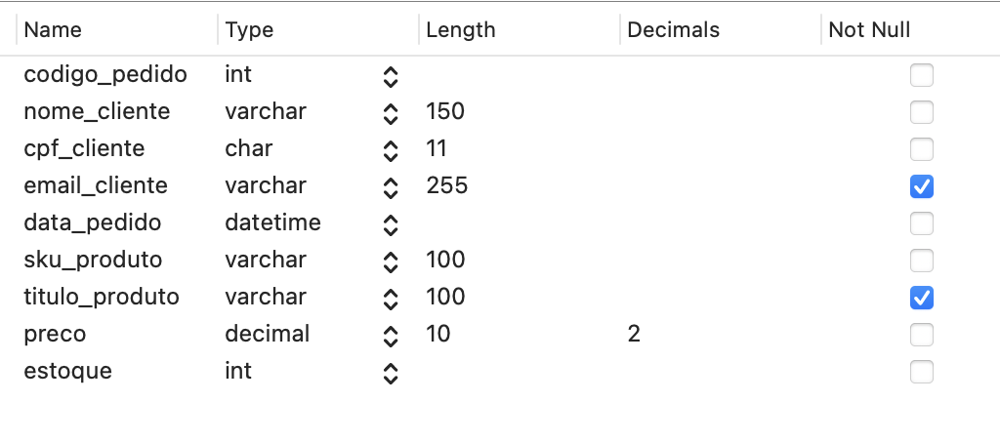

<div align="center">
  
</div>

# Teste para candidatos à vaga de Desenvolvedor

Nesse teste analisaremos seu conhecimento geral e inclusive velocidade de desenvolvimento. Abaixo explicaremos tudo o que será necessário.

## Instruções

O desafio consiste em implementar uma aplicação Web utilizando o framework PHP Laravel OU NodeJS + Express, e um banco de dados relacional SQLite, MySQL ou Postgres, a partir de uma modelagem de dados inicial desnormalizada, que deve ser normalizada para a implementação da solução.

Você vai criar uma aplicação de cadastro de pedidos de compra, a partir de uma modelagem inicial, com as seguintes funcionalidades:

- CRUD de clientes.
- CRUD de produtos.
- CRUD de pedidos de compra, com status (Em Aberto, Pago ou Cancelado).
- Cada CRUD:
  - deve ser filtrável e ordenável por qualquer campo, e possuir paginação de 20 itens.
  - deve possuir formulários para criação e atualização de seus itens.
  - deve permitir a exclusão de qualquer item de sua lista, importante conter uma mensagem de confirmação.
- Barra de navegação entre os CRUDs.
- Links para os outros CRUDs nas listagens (Ex: link para o detalhe do cliente da compra na lista de pedidos de compra)

## Modelo de dados

A modelagem inicial para a implementação solução é a seguinte:



Você deve alterar esta modelagem para que a mesma cumpra com as três primeiras formas normais.

Além disso, a implementação deste modelo em um banco de dados relacional deve ser realizada levando em consideração os seguintes requisitos:

- O banco de dados deve ser criado utilizando Migrations do framework Laravel, e também utilizar Seeds e Factorys para popular as informações no banco de dados. Se o seu projeto for em NodeJS solicitamos o uso do ORM Sequelize para a criação das migrations.
- Implementação das validações necessárias na camada que julgar melhor.

## Tecnologias a serem utilizadas

Devem ser utilizadas as seguintes tecnologias:

- HTML
- CSS
- Javascript
- Framework Laravel (PHP) ou NodeJS+Express
- Docker (construção do ambiente de desenvolvimento) (Adicional não obrigatório)

## Entrega

- Para iniciar o teste, faça um fork deste repositório; **Se você apenas clonar o repositório não vai conseguir fazer push.**
- Crie uma branch com o seu nome completo;
- Altere o arquivo teste1.md com as informações necessárias para executar o seu teste (comandos, migrations, seeds, etc);
- Depois de finalizado, envie-nos o pull request;

## Bônus

- Implementar autenticação de usuário na aplicação.
- Permitir que o usuário mude o número de itens por página.
- Permitir deleção em massa de itens nos CRUDs.
- Implementar aplicação de desconto em alguns pedidos de compra.
- Implementar a camada de Front-End utilizando a biblioteca javascript Materialize e ser responsiva.
- API Rest JSON para todos os CRUDS listados acima.

## O que iremos analisar

- Organização do código;
- Aplicação de design patterns;
- Separação de módulos e componentes;
- Legibilidade;
- Criação do ambiente com Docker.

### Boa sorte!

---

## Como executar

Aplicação em Laravel, usando SQLite. Requisitos: PHP 8.3 ou superior (com `pdo_sqlite`) e Composer.

```bash
cd pedidos
composer install
cp .env.example .env
php artisan key:generate
touch database/database.sqlite
php artisan migrate --seed
php artisan serve
```

Depois é só abrir http://localhost:8000.

### Com Docker

```bash
cd pedidos
docker compose up --build
```

Na primeira execução o container instala as dependências, gera a chave, cria o banco e roda migrations e seeds. O site fica em http://localhost:8000.

### Testes

```bash
php artisan test
```

Para recriar o banco do zero: `php artisan migrate:fresh --seed`.

## Modelagem

A tabela original (`codigo_pedido`, dados do cliente, dados do produto e preço/estoque tudo junto) foi separada em quatro tabelas, na 3FN:

- `clientes`: id, nome, cpf (único), email
- `produtos`: id, sku (único), titulo, preco, estoque
- `pedidos`: id, cliente_id, data_pedido, status (Em Aberto, Pago ou Cancelado)
- `item_pedidos`: id, pedido_id, produto_id, quantidade, preco_unitario

O `preco_unitario` é gravado no item para que uma mudança no preço do produto não altere pedidos antigos.

## Estrutura

- `database/migrations`, `database/factories` e `database/seeders`: criação e população do banco (30 clientes, 40 produtos e 50 pedidos)
- `app/Http/Requests`: validações de cada formulário
- `app/Http/Controllers`: um controller por CRUD
- `app/Services`: regra de negócio dos pedidos (itens e preço unitário)
- `app/Models/Concerns/Listavel.php`: filtro e ordenação reaproveitados nas listagens
- `resources/views`: telas em Blade, com layout, cabeçalho ordenável e paginação compartilhados

## O que foi feito

- CRUD de clientes, produtos e pedidos (os pedidos têm vários itens e status)
- Filtro por qualquer campo, ordenação por qualquer coluna e paginação de 20 itens
- Confirmação antes de excluir
- Barra de navegação e links entre as listagens (pedido para cliente e produto)
- Cliente com pedidos e produto presente em pedidos não podem ser excluídos
- Escolha de itens por página (10, 20, 50 ou 100) e exclusão em massa nas três listagens
- Mensagens de validação em português
- Regra de salvar pedido isolada em `app/Services/PedidoService.php`
- Testes de feature para os três CRUDs
- Ambiente com Docker
- Desconto percentual (0 a 100) no pedido, aplicado ao total
- API REST JSON para os três CRUDs em `/api` (ver seção "API")

## API

Todas as rotas respondem JSON. As listagens são paginadas (20 por padrão; `por_pagina` aceita 10, 20, 50 ou 100) e aceitam os mesmos filtros e ordenação das telas (`ordem`, `direcao=asc|desc` e `campo=valor`; pedidos filtram por `id`, `cliente`, `data_pedido` e `status`).

| Método | Rota | Descrição | Resposta |
|---|---|---|---|
| GET | `/api/clientes`, `/api/produtos`, `/api/pedidos` | Lista paginada | 200 |
| POST | `/api/clientes`, `/api/produtos`, `/api/pedidos` | Cria | 201 (422 se inválido) |
| GET | `/api/{recurso}/{id}` | Mostra um registro | 200 (404 se não existir) |
| PUT/PATCH | `/api/{recurso}/{id}` | Atualiza | 200 (422 se inválido) |
| DELETE | `/api/{recurso}/{id}` | Exclui | 204 (409 para cliente com pedidos e produto em pedidos) |
| DELETE | `/api/{recurso}` com `{"ids": [1, 2]}` | Exclusão em massa | 200 com `{"excluidos": n, "ignorados": n}` |

O pedido é enviado com `cliente_id`, `data_pedido`, `status`, `desconto` (opcional) e `itens` (`produto_id` e `quantidade`), e volta com cliente, itens, `subtotal`, `desconto` e `total`.
